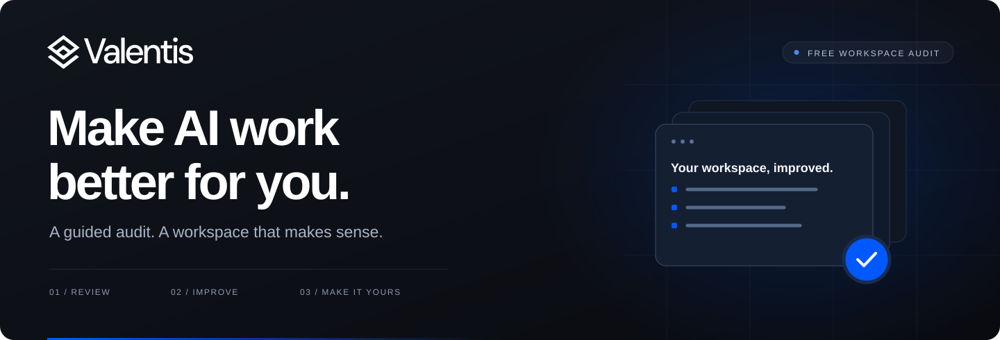

<p align="center"></p>

# Valentis AI Workspace Audit

Make your AI setup work better for the way you work.

A guided review of your files, instructions and workflows, followed by help putting the useful changes into practice. For solo work, teams and businesses. Bring your existing setup, or start with a folder and an idea.

## Start with one prompt

Open the folder you normally work in with Claude Code, Codex or another AI assistant that can read your files. Paste this:

```text
Read https://raw.githubusercontent.com/Valentis-AI-Labs-Ltd/ai-workspace-audit/main/START-HERE.md and start my Valentis AI Workspace Audit.
```

Your assistant will welcome you, then wait for **GO** before reviewing your workspace. It will adapt to your experience and explain the choices as you go.

**[Download the kit](https://github.com/Valentis-AI-Labs-Ltd/ai-workspace-audit/releases/latest/download/Valentis-AI-Workspace-Audit.zip)** · [Read the starting instructions](START-HERE.md) · [Visit Valentis](https://valentis.ai)

## Prefer to download?

1. Download and unzip the kit. Open **OPEN-FIRST.html** for the prompt and short instructions.
2. Keep the kit separate from your working files. You can place the whole folder inside your workspace without replacing anything.
3. Ask your assistant: **“Read START-HERE.md in the Valentis AI Workspace Audit kit and begin.”** If it cannot find the file, attach it or give its full path.

No GitHub account or terminal commands are needed to use the download. In a regular chat without folder access, attach `START-HERE.md`; the assistant will guide a smaller review using examples you choose to share. It cannot scan files it cannot access.

## What you will get

- A clear picture of what already works and the most useful improvements.
- A workspace structure that fits your work, with context an AI can actually find.
- Help improving one real task, saving a reusable method and making work easy to resume.
- Optional guidance on using Claude and Codex together, backups and a first scheduled routine.

The audit begins without changing your files. You choose which improvements to implement. There is no fixed folder system to adopt and no requirement to automate everything.

## Your work stays yours

The kit contains instructions and examples. It has no reporting service or analytics and does not send your audit to Valentis. Your chosen AI provider handles the material you give it under its own settings and terms. Only share files you are authorised to use, and keep credentials and private customer records out of shared examples.

Use and adapt the kit under the [MIT licence](LICENSE). For a system built around your business, [talk to Valentis](https://valentis.ai).

<sub>Version 1.0.0 · Product references checked 19 October 2026. Features and account access can change.</sub>
